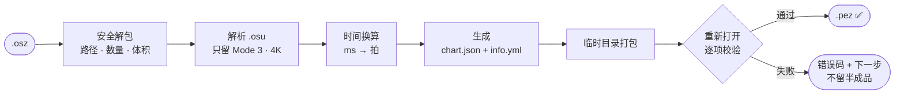

<div align="center">



# osz2pez

**把 osu!mania 4K 谱面包（`.osz`）转换成 Phira 可以导入的 RPE 谱面包（`.pez`）。**<br>
4 条轨道进去，1 条判定线出来。全程本地、离线，不改你的源文件。

<sub>Convert osu!mania 4K beatmaps (.osz) into Phira RPE charts (.pez) — offline, on Android or from the command line.</sub>

[](https://github.com/AkiraNyx/osz2pez/releases/latest)
[](https://github.com/AkiraNyx/osz2pez/releases)
[](LICENSE)


[**下载 APK**](https://github.com/AkiraNyx/osz2pez/releases/latest) · [App 用法](#用-app-转换) · [命令行](#命令行版) · [转换规则](#转换是怎么做的) · [已知问题](#已知问题)

</div>

---

## 它解决什么问题

osu!mania 的 4K 谱面是 4 条竖直轨道；Phira 的谱面是一条（或多条）会动的判定线。手动搬一张谱面，要把每个音符的毫秒时间换成拍数、把列号换成横坐标、把长条拆成起止时间、再按 Phira 的格式打包——几千个音符，算到天亮。

osz2pez 把这件事缩短成：**选文件 → 点导出**。

## 特性

| | |
|---|---|
| 🎯 **只做 4K，就把 4K 做准** | App 只转换 `Mode: 3` 且 `CircleSize: 4` 的难度；5K–18K 会明确报错，不会被硬塞进 4 列 |
| 🧮 **时间不漂** | 多段红线（BPM）、绿线（变速）逐段换算；用 BigInteger 有理数计算拍数，写成 RPE 的 `[整拍, 分子, 分母]`，没有浮点累积误差 |
| 🎹 **物件齐全** | Tap、Hold、同时押（和弦）；Tap 上引用的自定义打击音效会一起打进包里 |
| 🛡️ **解包有防线** | 路径穿越、绝对路径、重复/非法条目、条目数量与解压体积上限，逐条检查 |
| ✅ **写出前先复核** | 先在临时目录生成完整 `.pez`，重新打开逐项校验，全部通过才写到你选的位置；目标已存在时不覆盖，失败不留半成品 |
| 🔒 **不碰网络** | App 不申请任何权限（包括网络），通过系统文件选择器只读打开 `.osz` |
| 🧭 **出错说人话** | 41 个稳定错误码，每个错误都给出原因和下一步该做什么 |
| 📱 **两种用法** | Android App「Osu2Phira」（Jetpack Compose · Material 3，手机/平板自适应），以及一个单文件 Python 命令行工具 |

## 下载与安装

1. 到 [Releases](https://github.com/AkiraNyx/osz2pez/releases/latest) 下载 `Osu2Phira-v0.1.0-debug.apk`。
2. 在手机上打开安装（需要允许"安装未知应用"）。
3. 系统要求：**Android 8.0（API 26）及以上**。

> [!NOTE]
> v0.1.0 是 **debug 签名** 构建：可以正常安装使用，但它是可调试包，签名也不是正式发布密钥。以后版本改用正式签名时，需要先卸载旧版再安装新版。

## 用 App 转换

```text
① 选择 .osz  →  ② 调整设置（可选）  →  ③ 选定难度  →  ④ 导出 .pez  →  ⑤ 在 Phira 中导入
```

1. **选择 .osz**：系统文件选择器只读打开，应用会列出包内文件数和 `.osu` 数量。
2. **调整设置**：下面三项都有默认值，不改也能用。数值非法时导出按钮不可用。
3. **选定难度**：曲包里有多张 4K 难度时，必须明确选一张，不会悄悄替你选第一张。
4. **导出 .pez**：选择保存位置。生成、复核、写出都在后台完成，可随时取消。
5. 在 Phira 里导入这个 `.pez`。

| 设置 | 默认值 | 范围 / 步进 | 作用 |
|---|---|---|---|
| RPE 基准流速 | `16.5` | 0.1 – 100.0，步进 0.1 | 越大，音符下落越快 |
| 音频偏移 | 自动 | 手动：-2000 – 2000 ms，步进 1 ms | 自动：按首条红线、AudioLeadIn 和 400 ms 前奏计算 `META.offset`；手动：在自动值上再叠加 |
| 判定线位置 | `Y = -280` | -450 – 450，步进 1 | RPE 坐标；Y 越大判定线越靠下 |

设置草稿会保存下来；旋转屏幕或切到后台再回来，已选的文件和设置都不会丢。

## 命令行版

`osz2pez.py` 是单个文件，**只依赖 Python 标准库**（已在 Python 3.14 上通过自检）。

```bash
python osz2pez.py "Song.osz" -o output
```

和 App 不同，命令行版会把包里**每一个** `Mode: 3` 难度（1K–18K）各导出一个 `.pez`；中途任何一个失败，已生成的文件会被清理掉。

| 参数 | 默认值 | 说明 |
|---|---|---|
| `input` | — | 输入的 `.osz` 文件 |
| `-o`, `--output` | `output` | 输出目录 |
| `--speed-scale` | `1.0` | 流速校准倍数：以持续最久那段的滚速为 1，各段 RPE 流速 = 相对滚速 × 16.5 × 该倍数 |
| `--audio-offset-ms` | `75` | 额外的音频同步偏移（毫秒），正数让物件更晚出现 |
| `--self-test` | — | 运行内置自检，不需要输入文件 |

## 转换是怎么做的



拿一个音符走一遍（150 BPM，首条红线在 0 ms）：



| osu!mania | → | Phira RPE |
|---|---|---|
| 列号 `⌊x × 4 ÷ 512⌋` | → | `positionX = ((列 + 0.5) ÷ 4 − 0.5) × 1200`，即 −450 / −150 / 150 / 450 |
| 时间（毫秒） | → | 按红线分段累计拍数，再加 400 ms 前奏，编码为 `[整拍, 分子, 分母]` |
| 红线（BPM） | → | `BPMList` |
| 滚速变化（红线 BPM × 绿线变速） | → | 判定线的 speed 事件，以持续最久那段的滚速归一化，保留谱面有意的变速 |
| Tap / Hold | → | note `type` 1 / 2，Hold 记录起止时间 |
| 音频、曲绘、Tap 自定义音效 | → | 只复制实际引用的文件，文件名安全化、处理重名 |
| 标题、艺术家、谱师、难度名 | → | `META` 与 `info.yml`（`RPEVersion = 160`） |

生成的包不额外套目录：

```text
Song.pez
├── info.yml
├── chart.json
├── audio.mp3
└── bg.jpg
```

<details>
<summary><b>解包时检查什么</b></summary>

- 拒绝路径穿越（`../`）、绝对路径、非法条目和重复条目
- 条目数 ≤ 4096，单个文件 ≤ 256 MiB，解压总量 ≤ 512 MiB，路径长度 ≤ 4096 字符
- 只解压到应用自己的临时目录，任何失败都会清理临时文件；源 `.osz` 始终只读

</details>

<details>
<summary><b>写出前校验什么</b></summary>

完整的 `.pez` 先在临时目录生成，然后重新打开检查：

- ZIP 能打开，每个条目 CRC 正确
- `info.yml`、`chart.json` 等必需条目齐全，并且都在根目录
- 没有不安全的路径
- `META.song`、`META.background` 等引用的资源确实在包里
- 重新读出的 `info.yml`、`chart.json` 与生成时的内容逐字节一致
- `chart.json` 的字段、类型和 `RPEVersion` 符合预期
- 所有时间三元组合法（整拍在 i32 范围、分子 < 分母、分母在 u32 范围），结束时间不早于开始时间
- 音符只有 Tap / Hold 两种，每条判定线的 `numOfNotes` 与 Tap 数一致，Hold 不带打击音效

全部通过后才写入你选择的位置。

</details>

<details>
<summary><b>全部 41 个错误码</b></summary>

| 阶段 | 错误码 |
|---|---|
| 输入 | `INPUT_NOT_SELECTED` `UNSUPPORTED_FILE_TYPE` `URI_READ_FAILED` `TEMP_DIRECTORY_FAILED` |
| 解包 | `INVALID_ZIP` `EMPTY_ZIP` `ZIP_PATH_TRAVERSAL` `ZIP_ABSOLUTE_PATH` `ZIP_INVALID_ENTRY` `ZIP_DUPLICATE_ENTRY` `ZIP_ENTRY_LIMIT_EXCEEDED` `ZIP_ENTRY_TOO_LARGE` `ZIP_TOTAL_TOO_LARGE` `ZIP_ENTRY_READ_FAILED` |
| 解析 | `NO_OSU_BEATMAP` `UNSUPPORTED_MODE` `UNSUPPORTED_KEY_COUNT` `NO_MANIA_4K` `BEATMAP_SELECTION_REQUIRED` `MISSING_REQUIRED_FIELD` `INVALID_OSU_FIELD` `MISSING_TIMING_POINT` `INVALID_HIT_OBJECT` `UNSUPPORTED_OBJECT` `INVALID_HOLD` `INVALID_GREEN_LINE` `GREEN_LINE_BEFORE_RED` |
| 设置与时间 | `INVALID_RPE_SPEED` `INVALID_AUDIO_OFFSET` `INVALID_JUDGELINE_POSITION` `INVALID_TIMING` `RPE_TIME_OUT_OF_RANGE` |
| 资源 | `MISSING_RESOURCE` `MISSING_BACKGROUND` `EMPTY_RESOURCE` `UNSUPPORTED_RESOURCE` |
| 输出 | `OUTPUT_EXISTS` `OUTPUT_NOT_WRITABLE` `OUTPUT_WRITE_FAILED` `OUTPUT_VALIDATION_FAILED` `CANCELLED` |
| 其他 | `INTERNAL_ERROR` |

</details>

## 不做什么

- 不把 5K–18K 映射成 4K（App 遇到会明确报错；命令行版按原键数输出）
- 不转换故事板（`.osb`）和视频背景
- 只输出 RPE，不输出 PGR / PEC / PBC
- 不上传、不登录、不联网

## 已知问题

- **长时间游玩的稳定性还没有结论。** 在一台 Android 真机上，转换出的 `.pez` 已在 Phira 0.8.2 官方客户端中成功导入并完成短时游玩；但两次长时间游玩中出现过 Phira 进程的 native 崩溃（SIGABRT），原因尚未定位。如果你也遇到，欢迎提 issue，附上谱面的键数、BPM 变化和时长等信息（请不要上传受版权保护的谱面文件）。
- v0.1.0 是 debug 签名构建，见[下载与安装](#下载与安装)。
- 命令行 `--help` 里写的音频偏移默认值（+50）与实际默认值（75 ms）不一致，以实际值为准。

## 从源码构建

需要 **JDK 17** 和 **Android SDK（compileSdk 37）**，其余交给 Gradle Wrapper（Gradle 9.3.1 · AGP 9.1.1 · Kotlin 2.3.21）。

```bash
cd android
./gradlew assembleDebug          # Windows: gradlew.bat assembleDebug
# → app/build/outputs/apk/debug/app-debug.apk
```

SDK 位置通过 `ANDROID_HOME` 或 `android/local.properties` 提供。`android/app/src/test` 下是不依赖测试框架的自检程序（各自带 `fun main()`），可以在 IDE 里直接运行。

命令行版自检：

```bash
python osz2pez.py --self-test
```

<details>
<summary><b>项目结构</b></summary>

```text
osz2pez/
├── osz2pez.py                  # 单文件命令行版（仅标准库）
├── docs/assets/                # README 用的动画图
└── android/                    # Android App「Osu2Phira」
    └── app/src/
        ├── main/kotlin/com/akiranyx/osu2phira/
        │   ├── domain/         # 纯 Kotlin 转换核心：解包、解析、换算、序列化、校验
        │   ├── data/           # SAF 读写、导出服务、设置存储
        │   └── *.kt            # Compose 界面与 ViewModel
        └── test/               # 自检程序
```

</details>

## 许可证

osz2pez 以 [GNU General Public License v3.0 或更高版本](LICENSE)（`GPL-3.0-or-later`）发布：你可以自由使用、修改和再分发；分发修改版时，需要同样以 GPL 开源。

> osu! 是 ppy Pty Ltd 的商标；Phira 由 TeamFlos 开发。本项目是独立的第三方工具，与二者均无关联。<br>
> 谱面、音乐和曲绘的版权属于各自的作者。请只转换你有权使用的内容；未经许可，不要再分发由他人作品转换出的 `.pez`。
